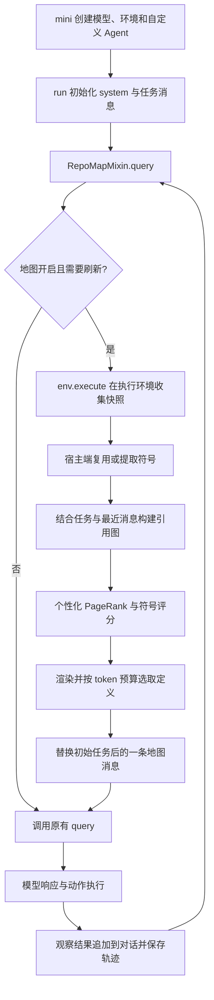

# 适配方法与处理流程

## 适配目标

[Aider 的 Repo Map](https://aider.chat/docs/repomap.html) 通过重要的类、函数、类型和调用签名帮助模型理解仓库，
再通过图排序将相关部分控制在 token 预算内。

本项目将这套思路放在 mini-swe-agent 的模型查询入口：Agent 每次刷新地图时，读取当前执行环境中的源码，
按任务和最近消息重排，然后把地图作为一条额外的 user 消息交给原有模型。
另提供 `refresh=once`：每个任务仅在首次查询前根据原始任务生成并注入一张地图，随后保持不变。

采用独立扩展包，通过 mini 原生的 `agent_class` 配置加载。
交互式命令确认、动作执行、模型调用、费用与步数限制、轨迹保存仍由 mini 原有实现负责。

## 接入点与模块职责

| 文件 | 职责 |
| --- | --- |
| [agent.py](../src/mini_swe_repomap/agent.py) | `RepoMapMixin.query()` 挂钩；交互式与非交互式 Agent；构造排名上下文和替换地图消息 |
| [settings.py](../src/mini_swe_repomap/settings.py) | `RepoMapConfig` 配置、默认值和数值范围校验 |
| [source.py](../src/mini_swe_repomap/source.py) | `EnvironmentSource` 通过 `env.execute()` 获取仓库快照，维护快照与指纹 |
| [_collect.py](../src/mini_swe_repomap/_collect.py) | 在目标执行环境中运行的纯标准库收集脚本 |
| [symbols.py](../src/mini_swe_repomap/symbols.py) | Tree-sitter 解析、定义与引用提取、签名和所在类型上下文 |
| [repomap.py](../src/mini_swe_repomap/repomap.py) | 解析缓存、引用图、个性化 PageRank、符号评分、地图渲染和 token 裁剪 |
| [cli.py](../src/mini_swe_repomap/cli.py) | 无模型预览，以及输出配置 overlay 的安装路径 |
| [config/](../src/mini_swe_repomap/config) | 两种 Agent 的 YAML overlay |

两个 Agent 共用 `RepoMapMixin`：

```text
RepoMapAgent            = RepoMapMixin + DefaultAgent
InteractiveRepoMapAgent = RepoMapMixin + InteractiveAgent
```

Mixin 更新上下文后调用 `super().query()`。mini 使用模块完整路径导入 Agent，因此无需改动上游源码。

## 一次模型查询的流程



1. `map_tokens=0` 时移除已有地图，跳过收集和注入。
2. `refresh=interval` 首次查询生成地图，之后在 `n_calls % refresh_interval == 0` 时刷新。
   `refresh=once` 每个任务只尝试一次收集和构建，后续查询跳过；空地图或非严格模式收集失败也不会反复重试。
3. `interval` 排名上下文包括原始任务，以及最近 `context_messages` 条非 system、非地图消息。
   最近消息提取出的文本最多保留末尾 24,000 个字符；原始任务另外保留。
   `once` 仅使用原始任务，不读取近期消息进行排序。
4. 构建后插入一条地图消息，再进入 mini 原有查询逻辑。`interval` 刷新时替换旧消息；`once` 不再替换。
5. `run()` 开始新任务时重置地图注入状态，确保各任务独立生成一次。

## 1. 从实际执行环境收集源码

`EnvironmentSource` 把 `_collect.py` 的文本和 JSON 参数组成命令，通过 `Environment.execute()` 执行。
参数经过 shell 引号处理，带空格或引号的路径也可以传递。

这使得 Local、Docker 等环境使用同一条收集路径：Docker 中的 `/testbed` 指容器内目录。
Tree-sitter、Tiktoken 和扩展包安装在宿主机，目标环境执行的收集脚本只依赖 Python 标准库。

文件选择遵循以下规则：

- Git 可用时运行 `git ls-files --cached --others --exclude-standard`，包含 tracked 文件和未被忽略的 untracked 文件。
  tracked 文件即使匹配 ignore 规则仍会列出，这是 Git 自身的语义。
- Git 不可用或当前目录不是 Git 仓库时遍历目录，排除缓存、依赖和构建目录；这个回退不解析 `.gitignore`。
- 排除符号链接、越出根目录的路径、已删除文件、常见二进制扩展名和超大文件。
- 支持语言的源码按 UTF-8 读取，跳过含空字节或无法解码的文件；其他文件只保留路径。
- 应用 `max_files`、`max_file_bytes`、`max_total_bytes` 限制。全局源码字节数上限只统计支持语言的源码。

脚本通过带固定前缀的一行 JSON 返回结果。宿主端仅从以协议前缀开头的输出行解析，
因此源码字符串里出现相同标记不会被当成协议边界。

## 2. 提取定义、签名和引用

根据文件后缀选择 Tree-sitter 语法，遍历 AST，提取主要的类、函数、方法、接口和类型定义。
当前支持 Python、JavaScript、TypeScript/TSX、Go、Rust、Java、C/C++、C#、Ruby、PHP。

每个符号记录名称、定义行号，以及渲染所需的源码行：

- 保留声明头和调用签名，包括参数和返回类型。
- 保留方法所在类型的声明上下文；Python 保留装饰器。
- 一个签名最多显示 12 行，每行最多 240 个字符。
- 从标识符 AST 节点统计引用，避免把普通注释、字符串中的单词当成引用。

未支持的语言、没有可识别定义的文件仍可在地图中以路径出现。

## 3. 构建引用图并排序

图中的节点是文件。文件 A 引用了文件 B 中定义的同名符号时，建立 `A → B` 的边。
这是同名符号关联，不能提供编译器级的类型解析、动态分派或完整调用图。

排序分成文件与符号两个层面：

1. 按引用频次的平方根计算边权，同名定义分摊权重；任务中提到的符号增加权重，私有名称降低权重。
   同名定义涉及超过 64 个文件时跳过该名称，限制歧义和图规模。
2. 任务中完整路径、路径组件、文件名或符号的匹配，形成文件个性化权重。
3. 使用阻尼系数 `0.85` 的个性化 PageRank；最多迭代 100 次，变化量小于 `1e-8` 时结束。
4. 将来源文件的排名沿边分配给目标符号，再结合文件排名及显式符号匹配，得到定义优先级。

解析缓存没有变化时，仍会按当前对话重新排序，使后续命令和观察结果可以影响地图选择。

## 4. 渲染并遵守 token 预算

本节描述默认 `mode=budget`。新增 `mode=full` 直接渲染全部收集到的路径与已提取定义，跳过图排序和预算选择；配合 `refresh=once` 与三个扫描上限设为 `null`，实现完整地图单次注入，详见 [实现与用法](full-once.md)。`map_tokens=0` 在两种模式下均关闭地图。

按定义优先级选择候选，再将同一文件的源码行合并，显示路径、行号、类型上下文和省略标记。
输出时文件按路径排序，因此最终显示顺序不等于排名顺序。

通过二分搜索选择预算内的候选前缀，并对每次候选文本使用 Tiktoken 实际编码计数。
`map_tokens` 包含 `<repository_map>` 标签和地图说明文本。

如果首个签名过长，尝试退化为文件路径；连标签、说明和路径也放不下时返回空地图。
预算按配置的编码定义，默认 `cl100k_base`，不代表任意模型的实际计费 token 数。

## 5. 替换上下文并保存轨迹

地图通过 `model.format_message(role="user", content=...)` 格式化，插入 `messages[2]`：

```text
system → 原始任务 → repository_map → assistant → 工具观察 → ...
```

每次刷新删除旧地图并插入新地图，始终最多保留一条。使用模型自己的消息格式化方法，
适配传统文本、tool calling 和 Responses 消息格式，并保留原有工具消息的相对顺序。

`once` 只插入一次，后续沿用 mini 的累计历史，因此同一地图仍会包含在后续模型请求中。
该模式不刷新已修改源码的签名或行号，模型需要通过读取实际文件确认内容。

地图随 mini 正常轨迹保存。替换早期消息会改变请求前缀，可能影响模型供应商的 prompt cache 命中率。

## 缓存和增量刷新

| 缓存层 | 变化判定 | 处理方式 |
| --- | --- | --- |
| 执行环境快照 | 根路径、文件路径、mtime、ctime、大小形成 SHA-256 指纹 | 未变化只返回指纹结果，复用宿主端源码快照 |
| 源码解析 | 按文件路径比较源码文本 | 内容不变复用符号；变化文件重新解析；已删除文件从缓存移除 |
| 排名与渲染 | 每次需要刷新时执行 | 使用当前任务和近期消息重新选择定义 |

仓库变化时重新读取受限源码快照；当前实现不逐文件传输差分。
缓存存在当前 Agent 实例的内存中，不在目标仓库创建缓存文件。

## 失败处理与验证范围

收集失败会转换成 `RepoMapError`。默认 `strict=false` 时记录警告、移除旧地图并继续原有 Agent；
`strict=true` 时抛出错误。配置校验、tokenizer 或其他非收集异常继续按原有异常机制传播。

当前验证覆盖多语言提取、token 上限、任务重排、修改和删除后的缓存更新、三种消息格式、
上游 CLI、真实 Docker 环境、安装包和完整 mini-swe-agent 仓库。
Tree-sitter 依赖约束为 `>=0.25.2,<0.26`，因为完整仓库连续解析时复现了 0.26.0 的原生崩溃。

预算模式采用固定地图预算；完整模式不按 token 数选择。两者均没有实现 Aider 根据打开文件状态自动扩容的策略。
Repo Map 能帮助定位文件和复用接口，实际修改仍需要读取源码并验证。
